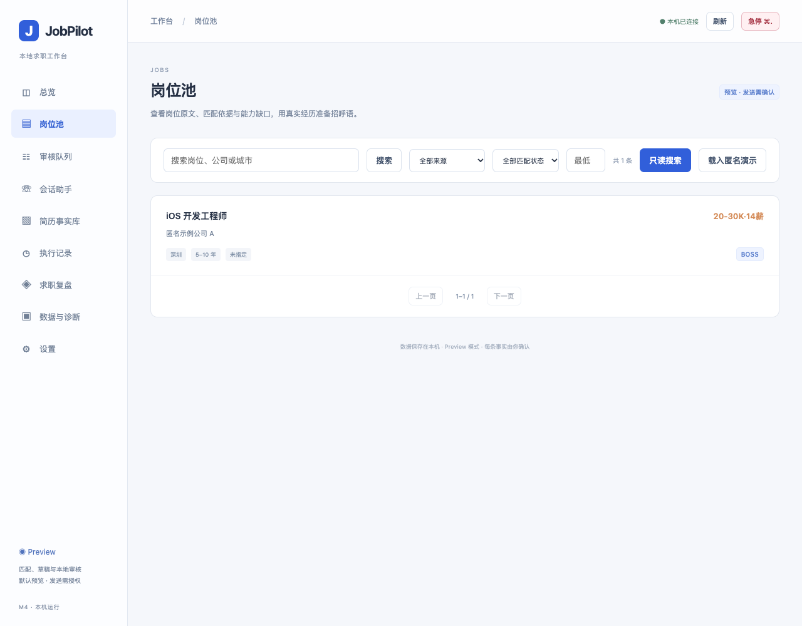

# JobPilot

运行在 Mac 上的 AI 求职工作台，当前支持 BOSS 直聘。将岗位采集、简历事实匹配、招呼语审核、求职沟通和结果复盘放在同一个桌面应用中。

JobPilot 根据岗位要求，从你确认过的真实经历中选择匹配证据并准备文案。你可以先预览、修改和审核，再决定是否发送。

[下载 macOS 应用](https://github.com/xiaoyu5/JobPilot/releases) · [安装与配置](docs/install-macos.md) · [使用指南](docs/usage.md) · [项目文档](docs/README.md)



## 主要功能

- **简历事实库**：导入 DOCX 或文字型 PDF，保留来源，逐条核对并冻结。更新简历时可合并去重，或替换旧简历并保留手动补充。
- **岗位采集与筛选**：使用专用 Chrome 登录 BOSS，采集岗位和 JD，按城市、薪资及排除条件筛选。
- **AI 匹配与文案**：展示岗位匹配依据和能力缺口，引用已确认经历准备中文招呼语，支持修改、事实审计和审核队列。
- **受控沟通**：区分首次招呼与已有会话；发送前确认接收人和最终文案，设置限额、时段及间隔，支持暂停和急停。
- **会话助手**：区分拒绝、等待回复和对方新问题，基于已确认事实准备回复；明确拒绝后停止联系。
- **企业微信提醒**：待审核或需人工处理时发送单向摘要提醒，回到 JobPilot 完成审核。
- **复盘与数据管理**：记录回复、拒绝和邀面，查看转化；提供脱敏诊断、私密备份、恢复和数据清理。
- **MCP 接入**：可通过兼容客户端读取岗位、执行匹配、生成草稿及管理任务，与桌面应用共享同一个 Worker。

## 开始使用

支持 **macOS 13+、Apple Silicon（M 系列）**。应用自带 Node 运行时，无需部署服务器；BOSS 功能需要 Google Chrome，模型通过你配置的本机或已授权局域网 OpenAI 兼容服务调用。

1. 从 [Releases](https://github.com/xiaoyu5/JobPilot/releases) 下载 DMG 并安装。当前为预发行版，采用临时签名，首次打开方式见[安装说明](docs/install-macos.md)。
2. 在“设置”配置模型地址、模型名和 API Key，测试连接。支持加载 `.env`，也可直接在应用内修改配置。
3. 导入简历，核对提取的事实并冻结版本。
4. 打开专用 Chrome，手动登录 BOSS，保存搜索方案并采集岗位。
5. 运行 Dry Run 或逐个匹配岗位，在审核队列核对和修改文案。
6. 需要真实沟通时，设置发送规则并确认具体目标与文案。

### 两种沟通入口

| BOSS 入口 | 页面行为 | JobPilot 的处理方式 |
| --- | --- | --- |
| **立即沟通** | 职位详情中的首次联系；点击即发送平台默认招呼，并弹出沟通窗口 | 按确认的计划发送默认招呼与 AI 文案，共两条；分别核验结果 |
| **继续沟通** | 已联系过的岗位，点击进入聊天消息页 | 按已有会话的历史和最新消息处理，不再执行首次招呼；已拒绝或等待对方回复时不重复打扰 |

默认只预览。首联 Auto 与聊天 Auto 分别授权；发送结果不确定时停止，不自动重发。完整操作和恢复方式见[使用指南](docs/usage.md)。

## 数据与隐私

配置、事实库、任务记录和专用 Chrome 登录目录保存在本机。必要 JD、已确认事实，以及回复所需的最新脱敏问题会发送至你配置的模型服务，该服务可能继续转发到远程模型；原始附件、Cookie、API Key 和聊天全文不发送给模型。

企业微信通知只包含待办数量与处理入口，不提供远程批准。验证码由你手动处理；应用不会自动修改在线简历、交换联系方式或发送简历附件。

## 从源码运行

需要 Apple Silicon Mac、Xcode Command Line Tools、Node **22.23.2**、Rust **1.99.1** 和 Google Chrome。

```sh
git clone https://github.com/xiaoyu5/JobPilot.git
cd JobPilot
npm ci
npm run prepare:sidecar
npm run desktop:dev
```

构建 App 和 DMG：

```sh
npm run desktop:build
```

应用使用 **Tauri / Rust + React / TypeScript**；Node Sidecar Worker 负责浏览器适配、模型工作流、任务执行和 MCP，SQLite 保存事实、审核及发送记录。

```text
apps/desktop/           桌面界面与 Tauri 宿主
packages/               浏览器、简历、模型、匹配、存储、Worker 与 MCP
extensions/boss-reader/ 可选的当前页面只读连接扩展
tests/                  匿名回归测试
docs/                   使用、开发、架构与验证文档
```

开发、测试和打包详见[开发指南](docs/development.md)，客户端配置见 [MCP 接入](docs/mcp.md)。技术决策、版本说明及实际验证范围统一收录在[文档索引](docs/README.md)。
